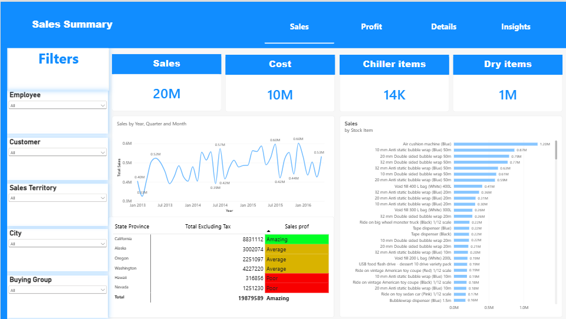
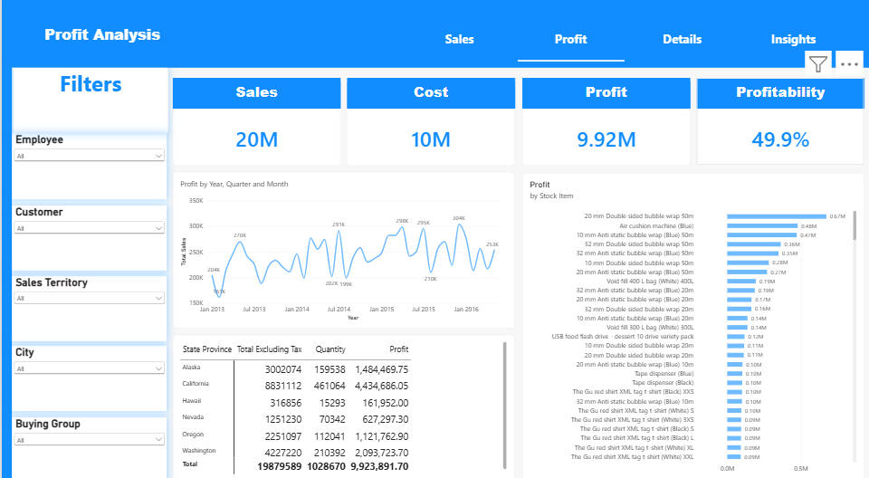
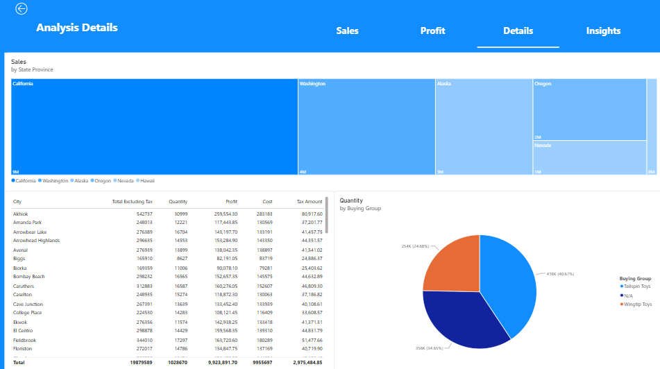
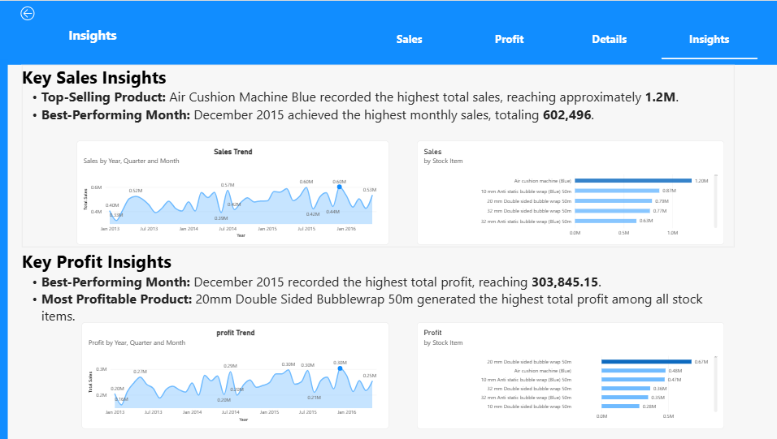

# 📊 Sales Analysis Dashboard | Power BI

<p align="center">
  
  
  
</p>

## 📌 Project Overview

This project focuses on analyzing sales data and developing an interactive Power BI dashboard to monitor business performance, identify sales trends, evaluate profitability, and generate actionable business insights.

The project transforms raw sales data into meaningful visualizations to support data-driven decision-making.

## 🛠️ Tools & Technologies

- Microsoft Power BI
- Power Query
- DAX
- Data Modeling
- Data Visualization
- Microsoft Excel

## 📂 Dataset Description

The project uses six datasets:

| Dataset | Description |
|---|---|
| FactSale.csv | Sales transaction records |
| DimCity.csv | City information |
| DimCustomer.csv | Customer details |
| DimDate.csv | Date dimension |
| DimEmployee.xlsx | Employee information |
| DimStockItem.csv | Stock item details |

## ⚙️ Project Workflow

1. Data Import and Exploration.
2. Data Cleaning and Transformation using Power Query.
3. Data Modeling and establishing relationships.
4. Creating DAX Measures and KPIs.
5. Designing interactive dashboards.
6. Analyzing results and extracting business insights.

## 📈 Dashboard Features

- Sales Performance Analysis
- Monthly Sales Trends
- Sales by Stock Item
- Sales by City
- Customer Analysis
- Employee Analysis
- Profit Analysis
- Interactive Filters and Slicers

## 📸 Dashboard Screenshots

### 1. Sales Summary

<p align="center">
  
</p>

### 2. Profit Analysis

<p align="center">
  
</p>

### 3. Detailed Analysis

<p align="center">
  
</p>

### 4. Business Insights

<p align="center">
  
</p>

## 💡 Key Business Insights

- Air Cushion Machine Blue was identified as the top-selling stock item, generating approximately 1.2M in sales.
- December 2025 recorded the highest monthly sales, reaching 602,496.
- 20mm Double Sided Bubblewrap 50m was identified as the most profitable stock item.
- Monthly profit trends were analyzed to evaluate business performance.

## 🎯 Project Objectives

- Develop practical Power BI and data analysis skills.
- Transform raw data into meaningful business insights.
- Build interactive dashboards for business reporting.
- Apply data modeling and analytical techniques.
- Support business decisions through data visualization.

## 📁 Repository Structure

```text
Sales-Analysis-PowerBI/
│
├── Dataset/
│   ├── DimCity.csv
│   ├── DimCustomer.csv
│   ├── DimDate.csv
│   ├── DimEmployee.xlsx
│   ├── DimStockItem.csv
│   └── FactSale.csv
│
├── Sales_Summary.png
├── Profit_Analysis.png
├── Analysis_Details.png
├── insights.png
├── Sales_Analysis_Dashboard.pbix
└── README.md
```

## 👨‍💻 Author

**Mahm
